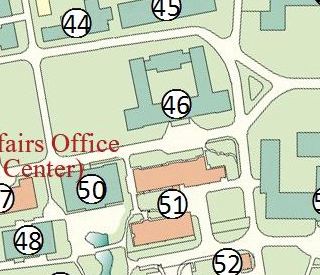
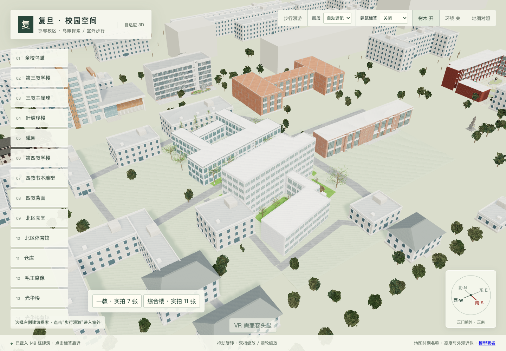
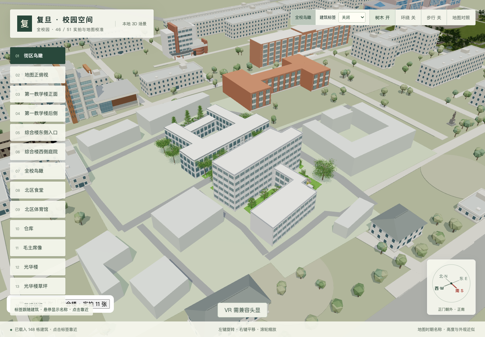
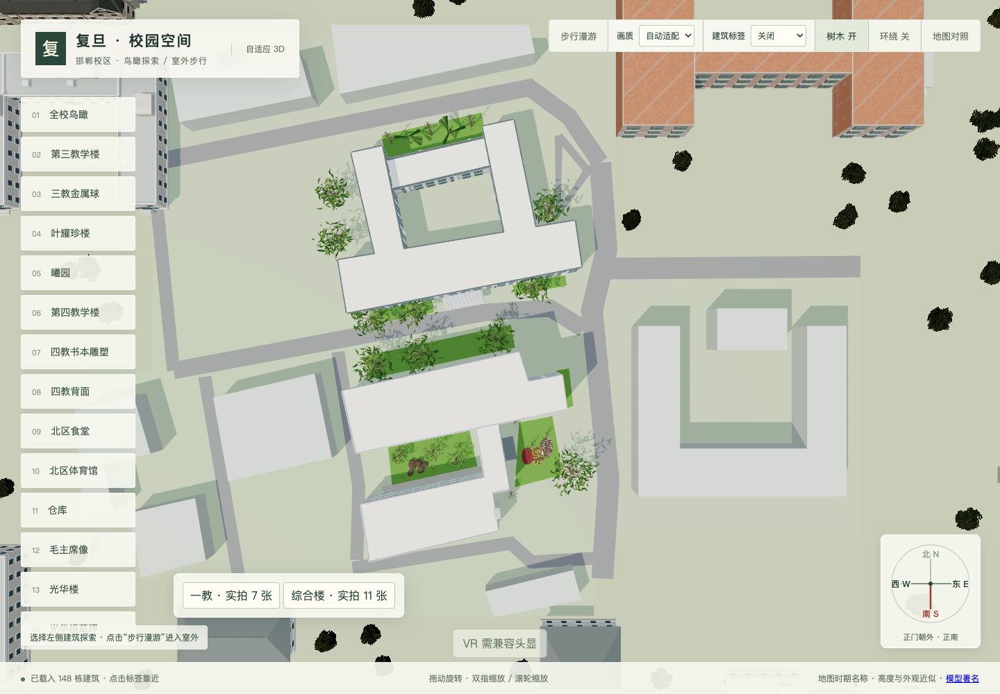

# 46/51 周边衔接修复

## 问题与修复

初次PR只加载了两栋楼与景观，排除了本地已有的7栋地图轮廓简模，导致它们与教师原校园中采用另一组位置、形状的邻楼共同显示。A05旧占位也重新出现在两楼通道上。局部展示另外受到全校园低分辨率阴影和环境补光影响，与本地版有明显差异。

本次恢复本地的完整街区校准范围：

- 46第一教学楼与51综合办公楼保持实拍细节；44、45、47、48、50、52、56按同一地图描点显示轮廓体量。
- 周边体量、道路、绿地、植物和标签采用共同变换 `(-167.2,0.5,-116)`。
- 三个LOD级别都保留邻楼轮廓，避免靠近或拉远时错位跳回旧位置。
- 远景采用覆盖树冠轮廓的稀疏叶片，中景保持在1 MiB以内，近景保留完整几何。植物使用独立细节名额，避免附近楼体耗尽名额后只剩树枝。
- 原版邻楼源文件保留；渲染和固定步行碰撞同时排除这片街区的旧体量、批量立面及A05占位。
- 地图区域恢复本地的光照、曝光和阴影范围，平面道路及草坪不再作为阴影投射体；离开区域恢复教师原有校园光照。

7栋邻楼为地图轮廓参考体量，详细的实拍复原对象为46和51。地图尺度沿用本地版的0.48场景单位/裁图像素；它确定相对布局。

## 对照

本地使用的原始地图裁图：

初次PR集成：

原本地版的同机位画面：

修复后的同机位鸟瞰：

北朝上俯视，可检查46/51、档案馆和理科图书馆的相对位置：

## 验证

实际解析远、中、近三个GLB，逐栋核对7栋邻楼的包围范围与描点轮廓，误差阈值2.5厘米（用于检查导出/量化漂移）。这不是实地测量误差。检查原共享全量与远景层的被替换旧楼清理，同时保护42/43已有模型。固定碰撞检查覆盖一教院落、综合楼西庭院、图书馆院内、三处楼体及A05旧占位通道。

原本地网页与本次提交版采用同一鸟瞰机位实测。全校园仍由教师新版加载器管理；校园外观更新（如树木和其他同学建筑）保留教师最新版。
