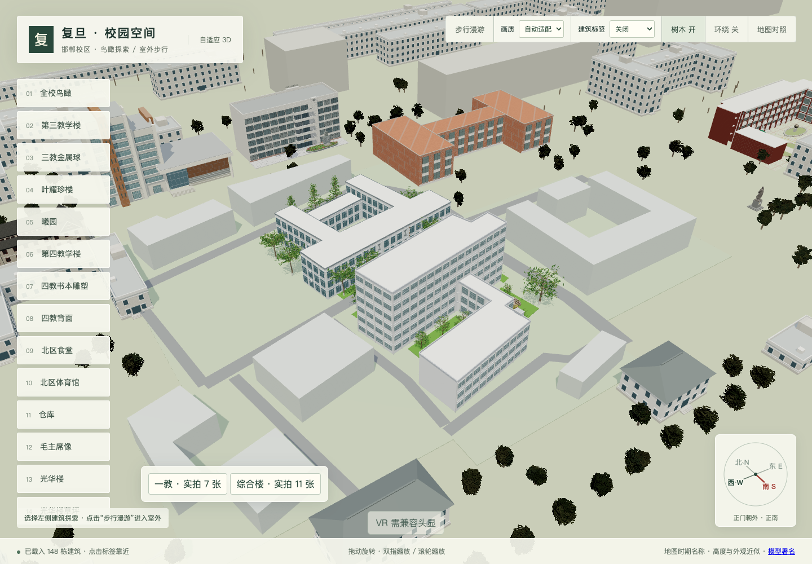
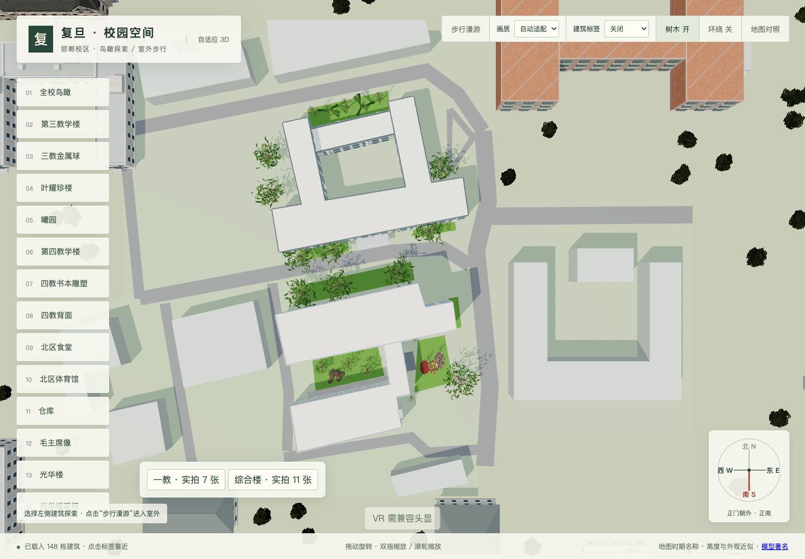
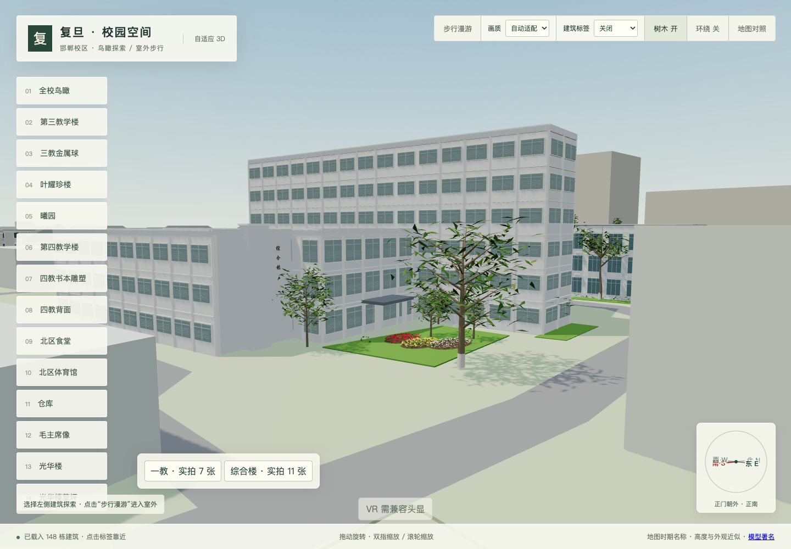
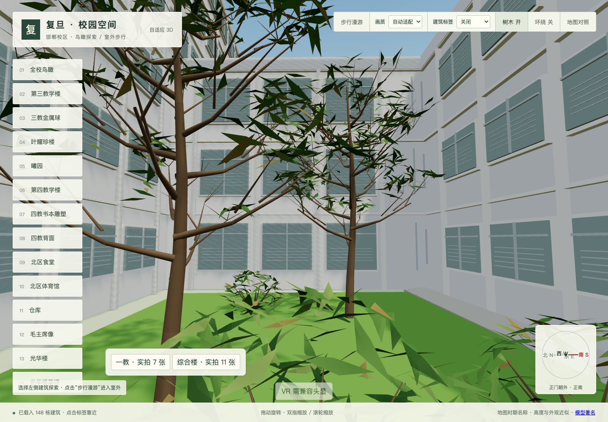
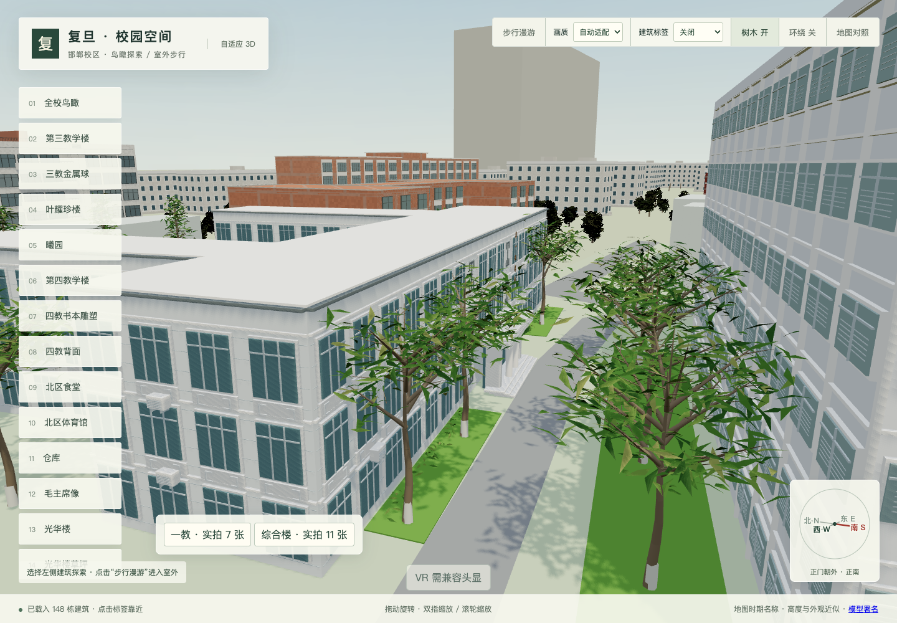
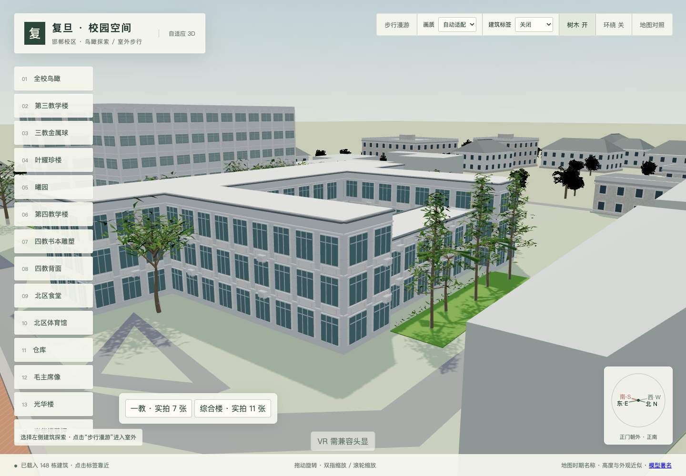
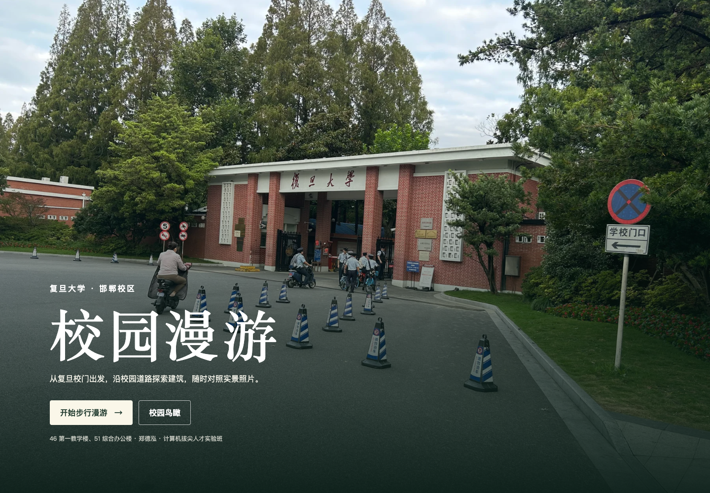

> 2026-11-23 合并修订：46/51 使用本 PR 实拍复原；44、45、47、48、50、52、56 保留主分支原有模型、位置和标签。尤其理科图书馆使用上一次精细模型及入口细节。发布用 landscape 的三个 LOD 已删除这七栋简模；碰撞和封闭室内区域已重新生成。以下原始投稿中的七栋地图简模仅保留在编辑源场景，未用于最终发布。

# 46 第一教学楼、51 综合办公楼实拍贡献

作者：郑德泓，计算机拔尖人才实验班。

## 本次内容

基于教师提交 `5419490` 集成两栋楼的地图描点体量、立面、竖排铜字和18张实拍参考。综合楼东入口补树木、曲线花坛与竹丛，西庭院补分枝植被与假山；第一教学楼保持主楼、两翼和低短翼的连续围合。

保留教师新版校门Landing Page、首人称步行、开闸逻辑、慢网分阶段加载及其他建筑成果。46/51为详细复原；44、45、47、48、50、52、56使用与本地版一致的地图体量简模，修正邻楼与道路的相对关系。原始共享GLB及周围建筑源文件不改，运行时排除其旧体量、残留立面及占据通道的A05占位。校准街区外继续使用教师新版校园。

新增：照片查阅、两栋楼的检查视角、可选WebXR会话与手柄/凝视瞬移。WebXR逻辑测试通过；真实头显测试单列为后续设备验收。

## 查看

进入 `web` 后 `npm ci`、`npm run dev`。首页保持校门入口，建筑检查链接：

- `?view=claimed`：街区与校园位置关系。
- `?view=claimed-top`：北朝上的地图俯视对照。
- `?view=teaching` / `?view=teaching-rear`：第一教学楼正面、后侧。
- `?view=office` / `?view=office-court`：综合楼东入口、西庭院。
- 网页照片面板：46目录7张，51目录11张；51/6实际是一教及邻接道路，界面已注明。

Pages构建仍使用 `/FudanCampus/`，照片URL与其他模型资源支持子目录部署。

### 网页实测预览

街区鸟瞰（46 第一教学楼位于51 综合办公楼北侧）：





地图依据及初次集成差异见 [周边衔接修复说明](CONTEXT_ALIGNMENT.md)。

综合办公楼东入口与西庭院：




第一教学楼及校门首页：





## 资产和坐标

- `web/public/map-review/components/{46,51}.glb`：两栋独立建筑。
- `web/public/map-review/runtime/landscape-near.glb`：周边植物、道路、庭院与7栋地图轮廓简模。
- `campus-manifest.json` 保存原始资产，`campus-lod.json` 保存远、中、近三级引用。
- 局部像素原点 `(176,107)`、比例 `.48`；GLB为Y-up；统一位置 `(-167.2,.5,-116)`，标签与相机共用变换。
- `assets/map-traced-neighbourhood.blend`：可编辑场景。源码生成器为 `scripts/build_map_neighbourhood.py`、`courtyard_geometry.py` 和 `perimeter_vegetation.py`。

近景保留完整建筑和叶片，远景按材质压缩并降低景观密度。新首批资源约43.11MB、248.57万三角形，维持原工程首屏预算。

## 重建与验证

先备份已有源场景。Blender字体定位目前使用macOS行楷；其他系统请调整生成器 `text()` 的字体路径。生成与检查命令在仓库根目录运行：

```sh
blender -b --python scripts/build_map_neighbourhood.py
node web/build-claimed-lods.mjs
node web/build-walk-collision.mjs
# 该步骤需要 Python shapely
python3 scripts/union_walk_interiors.py
blender -b --python scripts/validate_map_joints.py
node web/validate-claimed-integration.mjs
node web/validate-xr.mjs
cd web
npx tsc --project tsconfig.app-check.json
npm run build:pages
npm run test:lod
npm run test:walk
npm run test:claimed
```

修改运行时模型时同步重建碰撞与院落边界，防止可视模型更新后留下不可见旧墙。`claimed-area.mjs` 与 `CampusPatch.ts` 定义替换范围；回归测试确认历史全量与远景层的4808个旧一教细节三角形均清零，43号邻楼三个主体网格保留。其余受保护资产继续由原有验证器检查。

照片及几何验证JSON随本目录提供。期末论文与私人交互记录使用课程提交通道，本PR集中交付校园资产与代码。
